# Ayan Ali Saleem

**MSc Robotics & Artificial Intelligence, ITMO University — 4.85/5.0, Red Diploma (honours). BE Electrical Engineering, NED University of Engineering and Technology, Karachi.**
I build autonomous systems that **see, decide, and move**: training-free 3D perception from camera + LiDAR, depth-supervised 3D reconstruction, and hierarchical planning and control. **I am applying for PhD positions in perception, 3D reconstruction, motion planning, and autonomous navigation.**

---

## ▶ My planning stack, running — TriLayer-Nav

*Figure 1 — I combine A\* global planning, DWA local avoidance, and MPC trajectory tracking for a differential-drive robot in MuJoCo. This is the system from my Gyroscopy and Navigation paper (I am second author). Code: [TriNav-Tri-Layer-Navigation-A-DWA-MPC-](https://github.com/ayanali827/TriNav-Tri-Layer-Navigation-A-DWA-MPC-).*

---

## 🔬 Selected work

| Project | What I built | Measured result |
| --- | --- | --- |
| **3D perception for autonomous ground vehicles** — *MSc thesis* | I built a training-free pipeline — YOLOv8m-seg → calibrated LiDAR projection → adaptive mask erosion → DBSCAN → PCA oriented 3D boxes — that needs **no 3D training data**. | KITTI: **Car IoU 50.51% · Pedestrian IoU 38.63%** · ~11 FPS · 1,874 MiB peak GPU. *Code release in preparation.* |
| **TriLayer-Nav** | I co-developed a tri-layer navigation stack: A\* → DWA → MPC → PID for differential-drive robots, evaluated in MuJoCo. | **Published** — *Gyroscopy and Navigation*, 2026. [Code](https://github.com/ayanali827/TriNav-Tri-Layer-Navigation-A-DWA-MPC-) |
| **Depth-supervised NeRF** | I compared hard, soft, and hybrid depth integration under one controlled protocol on NeRF Synthetic. | Evaluated with PSNR / SSIM / depth error. [Code + notebooks](https://github.com/ayanali827/depth-supervised-nerf-notebooks) |
| **YOLO benchmark on KITTI** | I benchmarked YOLOv8 / YOLO11 / YOLO12 like-for-like on a 954-image KITTI subset. | **mAP@0.5: 75.6 / 74.8 / 73.2** · 42–45 FPS. [Code + results](https://github.com/ayanali827/object-detection-autonomous-navigation-yolo) |
| **Citation reliability of small LLMs** | I verified 850 LLM-generated references against Crossref / OpenAlex across 45 topics. | REAL_OK rate **0.39 on famous topics → 0.03 on niche topics**. [Code](https://github.com/ayanali827/citation-reliability-small-llms) |

## 🖥️ My research, as one system

*Figure 2 — I designed this console from my own benchmark tables: the top half is my pipeline blueprint with the data flow animated; the bottom half plots my measured thesis and YOLO results.*

---

## 📄 Publications

- Mughal, U. A. B., **Ali, A.**, Urwa, & Abramchuk, M. V. **TriLayer-Nav: A Tri-Layer Navigation Framework Integrating A*, Dynamic Window Approach, and Model Predictive Control for Differential-Drive Robots** — *Gyroscopy and Navigation*, 2026, Vol. 17, No. 1, pp. 24–33. [Publisher page](https://link.springer.com/article/10.1134/S2075108726700094)

- **Improving NeRF Training Quality Using Depth Data: A Comparative Study of Depth-Integration Strategies for 3D Scene Reconstruction** — 2026, manuscript under review. Code: [depth-supervised-nerf-notebooks](https://github.com/ayanali827/depth-supervised-nerf-notebooks)

## 🛠️ Methods

**Methods & tools:** A* · DWA · MPC · PID · UKF · DBSCAN · PCA · YOLO · NeRF · Python · PyTorch · OpenCV · Open3D · ROS · MuJoCo · MATLAB · C/C++ · LaTeX

## 📫 Contact

[LinkedIn](https://www.linkedin.com/in/ayan-saleem) · [Portfolio](https://ayanali.tech) · [ORCID](https://orcid.org/0009-0004-4690-1346) · [Email](mailto:ayansaleem827@gmail.com)
