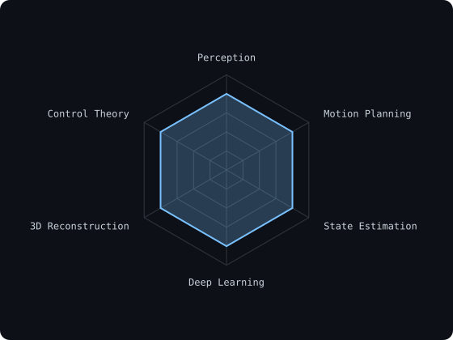
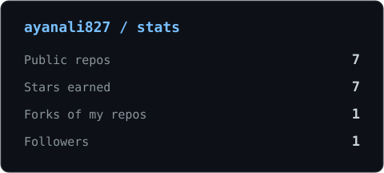

<picture>
  <source media="(prefers-color-scheme: dark)"  srcset="assets/banner-dark.svg">
  <source media="(prefers-color-scheme: light)" srcset="assets/banner-light.svg">
  
</picture>

 

  

&nbsp;
&nbsp;

  

---

## About me

Hi, I'm **Ayan**, a robotics and AI researcher with an MSc in Robotics & AI from ITMO University (Saint Petersburg). I build autonomous systems that reason about space, combining environmental perception with motion planning for reliable navigation in constrained environments.

- 🎓 **MSc, Robotics & AI**, ITMO University (with honours); **BE, Electrical Engineering**, NED University, Karachi
- 🔬 **Thesis:** training-free 3D perception for autonomous ground vehicles (YOLOv8-seg + LiDAR fusion, evaluated on KITTI)
- 🧭 **Navigation:** A\*, DWA, MPC, PID, UKF state estimation
- 👁️ **Vision:** YOLO benchmarking, stereo vision, depth-supervised NeRF
- ⚡ Background in power systems and classical control, which I carried into robotics
- 🌍 Based in Karachi · Open to PhD and research collaborations

---

## Tech stack

---

## Selected work

| Project | What it is | Stack |
|---|---|---|
| **3D Perception for Autonomous Ground Vehicles** (MSc thesis) | Training-free pipeline: YOLOv8m-seg → calibrated LiDAR projection → adaptive mask erosion → DBSCAN → PCA 3D oriented boxes. KITTI: Car IoU 50.51%, Pedestrian IoU 38.63%, ~11 FPS, 1,874 MiB peak GPU memory | Python, PyTorch, open3d |
| **[TriLayer-Nav](https://link.springer.com/article/10.1134/S2075108726700094)** | Tri-layer navigation framework (A\*, DWA, MPC) for differential-drive robots; *Gyroscopy and Navigation* | Python, MuJoCo |
| **[Depth-Supervised NeRF](https://github.com/ayanali827/depth-supervised-nerf-notebooks)** | Comparative study of depth-integration strategies for NeRF training quality | PyTorch |
| **YOLO benchmark on KITTI** | YOLOv8/11/12 compared on mAP@0.5, mAP@0.5:0.95, FPS, FLOPs, class-wise results | PyTorch |
| **Multi-Agent Study & Coding Assistant** | 8-agent LangChain/LangGraph system with a Reviewer agent for hallucination detection, evaluated on SWE-bench Lite | LangGraph |
| **Citation Reliability of Small LLMs** | Verified 400+ generated references via Crossref/OpenAlex/arXiv across 45 topics | Python |

---

## Publications

- **TriLayer-Nav: A Tri-Layer Navigation Framework Integrating A\*, DWA, and MPC for Differential-Drive Robots**, *Gyroscopy and Navigation* (2026)
- **Improving NeRF Training Quality Using Depth Data: A Comparative Study of Depth-Integration Strategies for 3D Scene Reconstruction** (2026)
- **A Hybrid ARIMAX–LSTM Framework for Robot-Assisted PM2.5 Forecasting and Adaptive Environmental Monitoring**, *Atmospheric Research* (under review)

---

## Signals

<table>
<tr>
<td width="50%" align="center" valign="middle">

<picture>
  <source media="(prefers-color-scheme: dark)"  srcset="assets/radar-dark.svg">
  <source media="(prefers-color-scheme: light)" srcset="assets/radar-light.svg">
  
</picture>

</td>
<td width="50%" align="center" valign="middle">

<picture>
  <source media="(prefers-color-scheme: dark)"  srcset="assets/card-stats-dark.svg">
  <source media="(prefers-color-scheme: light)" srcset="assets/card-stats-light.svg">
  
</picture>

<picture>
  <source media="(prefers-color-scheme: dark)"  srcset="assets/card-langs-dark.svg">
  <source media="(prefers-color-scheme: light)" srcset="assets/card-langs-light.svg">
  
</picture>

</td>
</tr>
</table>

---

perception · planning · autonomy

